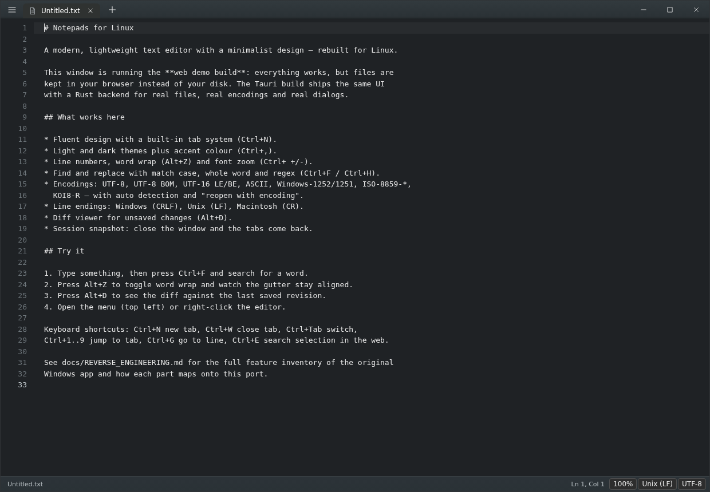
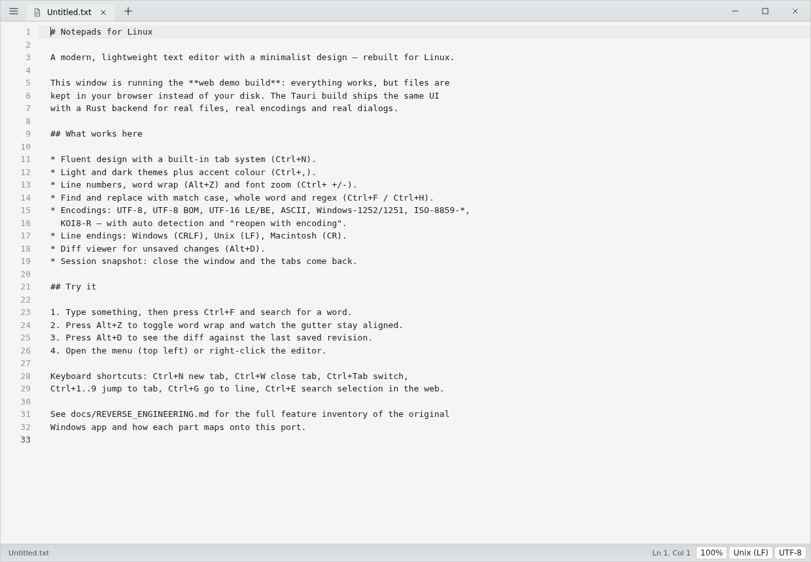
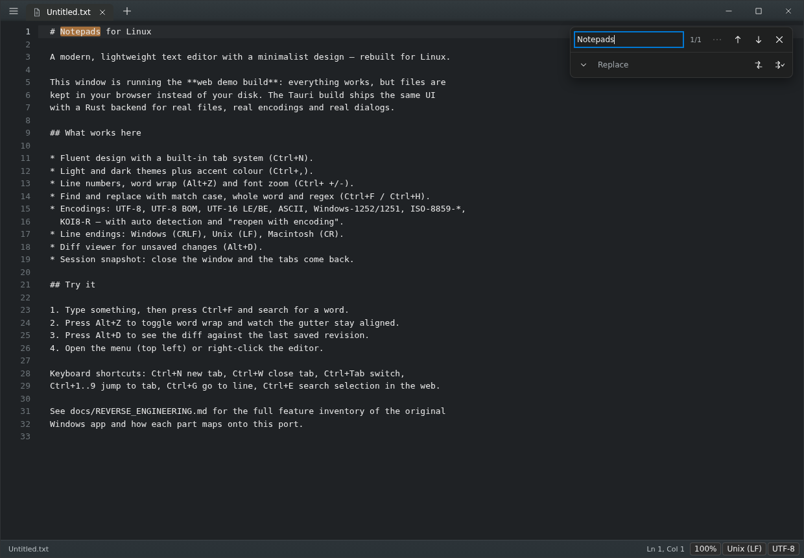
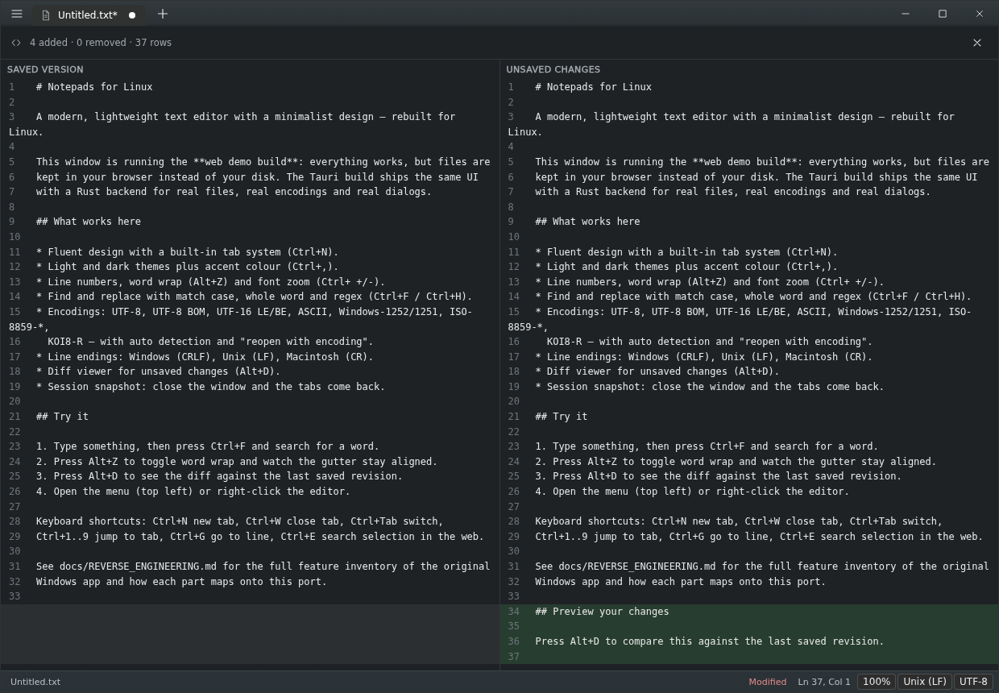
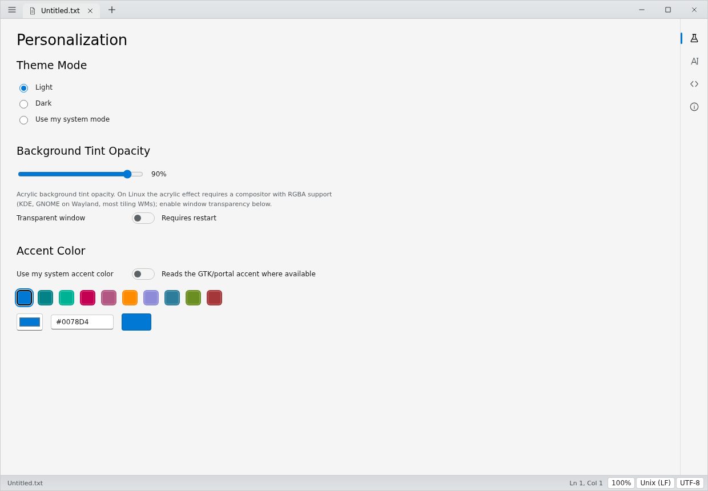
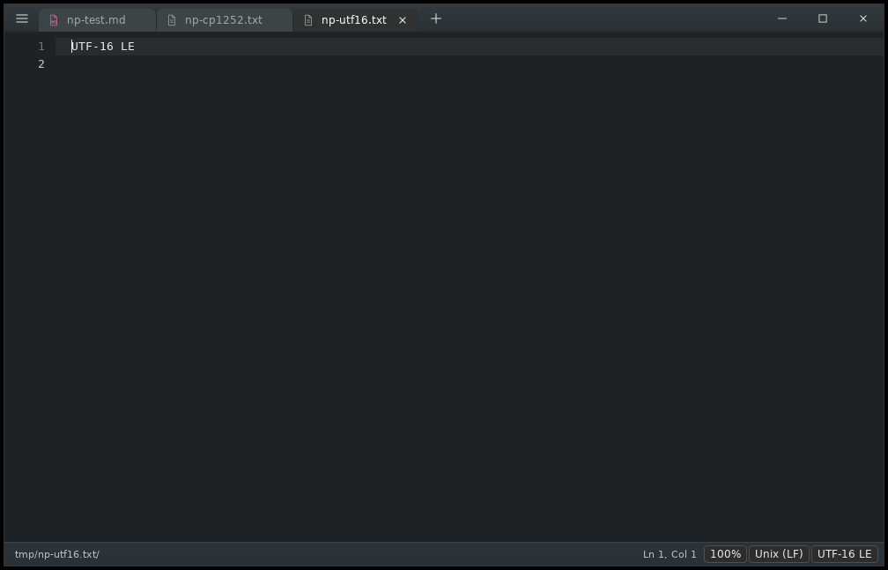
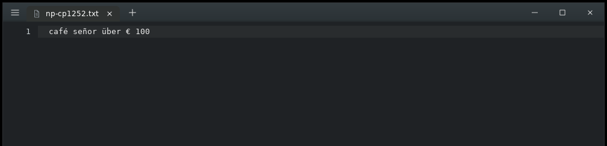

<div align="center">


# Notepads for Linux

**Un editor de texto moderno, ligero y con diseño minimalista — reescrito para Linux.**

Es una reimplementación libre, para escritorio Linux, del editor
[Notepads](https://github.com/0x7c13/Notepads) de Jackie (Jiaqi) Liu:
mismo diseño Fluent, mismo sistema de pestañas, mismos atajos, misma barra de estado.
Pero escrito desde cero en **Rust + Tauri**, sin una línea de UWP.

[](https://github.com/buntaroumori/NotepadsLinux/actions/workflows/ci.yml)
[](https://github.com/buntaroumori/NotepadsLinux/releases)
[](https://github.com/buntaroumori/NotepadsLinux/releases)
[](LICENSE)
[](#requisitos)

</div>

[](https://github.com/buntaroumori/NotepadsLinux/actions/workflows/ci.yml)
[](https://github.com/buntaroumori/NotepadsLinux/releases)
[](https://github.com/buntaroumori/NotepadsLinux/releases)
[](LICENSE)
[](#requisitos)

---

## Por qué existe esto

El Notepads original es **solo para Windows**: es una app UWP (C# + XAML) que depende de
WinUI, `RichEditBox`, Win2D y las APIs de Windows. No hay forma de ejecutarla en Linux,
ni con Wine de forma razonable.

Este proyecto toma la aplicación original como **especificación pública** —su README, sus
recursos de localización y sus capturas— y la reconstruye para Linux con el mismo
lenguaje visual y el mismo comportamiento, hasta el punto de reutilizar los textos
exactos de la interfaz para que la memoria muscular no se rompa.

El resultado se ve así:

| Tema oscuro | Tema claro con acento personalizado |
|---|---|
|  |  |

| Buscar y reemplazar | Visor de diferencias (`Alt+D`) |
|---|---|
|  |  |

| Ajustes: personalización |
|---|
|  |

Y esto es el **binario nativo** (Rust + WebKitGTK) ejecutándose sobre un X virtual durante
la verificación, abriendo tres archivos desde la línea de comandos y decodificando
correctamente un archivo ANSI/Windows-1252 con acentos y símbolo del euro:

| `notepads-for-linux a.md b.txt c.txt` | Windows-1252 → `café señor über € 100` |
|---|---|
|  |  |

<sub>El método de verificación sin pantalla está documentado en `docs/BUILD.md` §9: es el
que descubrió que los archivos UTF-16 se rechazaban como binarios.</sub>

---

## Lo que hace

**Núcleo del editor**
- Sistema de pestañas con `Ctrl+N`, `Ctrl+W`, `Ctrl+Tab`, `Ctrl+1..9`, cierre con clic
  central, reordenación arrastrando y menú contextual completo.
- Números de línea exactos (también con *word wrap* activo), resaltado de la línea
  actual, zoom de fuente, tabulación real y dirección LTR/RTL.
- Undo/redo con agrupación por tiempo, `Shift+Tab`, autoguardado de estado por pestaña.

**Buscar y reemplazar**
- Tarjeta flotante idéntica a la del original: `Ctrl+F`, `Ctrl+H`, `F3`, `Shift+F3`.
- *Match case*, *Match whole word* y **regex**, con aviso `Invalid regex` cuando el
  patrón no compila. Resaltado de todas las coincidencias y contador `n/total`.

**Archivos y codificaciones**
- Detección automática de encoding (BOM → UTF-8 → UTF-16 → ANSI) y reopertura o guardado
  con otro códec: UTF-8, UTF-8 BOM, UTF-16 LE/BE, ASCII, Windows-1252, Windows-1251,
  ISO-8859-1, ISO-8859-15, KOI8-R.
- Finales de línea Windows (CRLF) / Unix (LF) / Macintosh (CR), detectados al abrir y
  convertidos al guardar, con indicador conmutable en la barra de estado.
- Aviso de «archivo modificado fuera de Notepads» con opción de recargar desde disco.
- Archivos binarios detectados y protegidos (no se abren por accidente).

**Escritorio**
- Tema claro, oscuro o **el del sistema**, con color de acento personalizable (paleta,
  rueda de color y hex) y opacidad del tinte de acrílico.
- **Snapshot de sesión**: cierra la ventana y vuelven tus pestañas, incluido el texto que
  no habías guardado.
- Multi-ventana, instancia única y CLI: `notepads-for-linux notas.md` abre el archivo en
  la ventana que ya tengas abierta.
- Sin telemetría. Cero peticiones de red.

---

## Requisitos

| | |
|---|---|
| Sistema | Cualquier distro con **WebKitGTK 4.1** y GTK 3 (Ubuntu 22.04+, Debian 12+, Fedora 38+, Arch, openSUSE) |
| Escritorio | X11 o Wayland, GNOME, KDE, Xfce, tiling WMs… |
| Para compilar | Rust ≥ 1.77, Node ≥ 18, `libwebkit2gtk-4.1-dev`, `libgtk-3-dev` |

---

## Empezar

### Probarlo sin instalar nada

```bash
npm ci && npm run demo     # genera un HTML autocontenido con la app entera
xdg-open demo/notepads-for-linux-demo.html
```

La demo en un solo archivo tiene toda la interfaz, los atajos y los ajustes. Lo único
que no puede hacer es tocar tu sistema de archivos: en el navegador los documentos
viven en memoria. Para eso está la aplicación real.

### Instalar de forma permanente

```bash
git clone https://github.com/buntaroumori/NotepadsLinux.git
cd notepads-for-linux
./scripts/install.sh
```

El script comprueba las dependencias, compila, e instala el binario, el lanzador, los
iconos y las asociaciones de archivos en `~/.local`. Con `--system` lo pone en
`/usr/local`, y con `--uninstall` lo quita todo.

### Desarrollo

```bash
npm install
npm run dev        # ventana con recarga en caliente
npm test           # tests del editor y del shell (jsdom)
npm run bundle     # .deb + .rpm + .AppImage
```

Guía completa —dependencias por distro, paquetes, AUR, problemas conocidos— en
[`docs/BUILD.md`](docs/BUILD.md).

---

## Atajos

| Atajo | Acción | | Atajo | Acción |
|---|---|---|---|---|
| `Ctrl+N` / `Ctrl+T` | Nueva pestaña | | `Ctrl+F` / `Ctrl+H` | Buscar / Reemplazar |
| `Ctrl+Shift+N` | Nueva ventana | | `F3` / `Shift+F3` | Siguiente / anterior |
| `Ctrl+O` | Abrir | | `Ctrl+G` | Ir a línea |
| `Ctrl+S` / `Ctrl+Shift+S` | Guardar / Guardar como | | `Ctrl+E` | Buscar selección en la web |
| `Ctrl+Alt+S` | Guardar todo | | `Alt+Z` | Word wrap |
| `Ctrl+W` | Cerrar pestaña | | `Alt+D` | Ver diferencias |
| `Ctrl+Tab` / `Ctrl+1..9` | Cambiar de pestaña | | `Ctrl+L` / `Ctrl+R` | Dirección del texto |
| `Ctrl++` / `Ctrl+-` / `Ctrl+0` | Zoom | | `Ctrl+,` | Ajustes |
| `F2` | Renombrar en disco | | `Alt` | Menú principal |

Las mismas que el original, más las que cualquier usuario de Linux espera encontrar.

---

## Arquitectura

```
┌──────────────────────────────────────────────────────────────────────┐
│  WebView (WebKitGTK)                                                 │
│  ┌────────────────────────────────────────────────────────────────┐  │
│  │ app.js        pestañas · menús · diálogos · ajustes · sesión    │  │
│  │ editor.js     textarea + capa espejo + gutter                   │  │
│  │ diff.js       LCS por líneas para el visor Alt+D                │  │
│  │ icons.js      set de iconos 16 px                               │  │
│  │ bridge.js  ──► la única puerta al sistema                       │  │
│  └────────────────────────────────────────────────────────────────┘  │
└──────────────────────────────┬───────────────────────────────────────┘
                               │  IPC (comandos, sin plugin fs)
┌──────────────────────────────▼───────────────────────────────────────┐
│  Rust · Tauri 2                                                      │
│  read_text_file / save_text_file  ·  detección y conversión de       │
│  codificaciones  ·  normalización CRLF/LF  ·  multi-ventana  ·       │
│  instancia única + CLI  ·  session.json / settings.json  ·  bandeja  │
└──────────────────────────────────────────────────────────────────────┘
```

Tres decisiones que explican todo lo demás:

1. **El `<textarea>` nativo es el editor.** Se obtiene cursor, selección, IME, scroll y
   accesibilidad del propio motor del navegador, a coste cero. Encima hay una **capa
   espejo** con la misma tipografía, padding y modo de ajuste, que pinta las
   coincidencias y la banda de línea actual. Es la razón de que el editor sea fluido con
   documentos grandes sin convertir el proyecto en un Monaco.
2. **Nada de `plugin-fs`.** Todas las operaciones de archivo pasan por comandos Rust
   propios que hablan en bytes y convierten con el códec explícito, que es la única forma
   de que UTF-16 y Windows-1252 sobrevivan a un ciclo abrir-guardar sin corromperse.
3. **El frontend no sabe dónde corre.** `bridge.js` es el único módulo que conoce Tauri;
   en un navegador normal degrada a la API del navegador. Por eso la demo de un solo
   archivo existe, y por eso los tests pueden ejecutar la app entera en jsdom sin
   arrancar WebKit.

---

## Tests

```bash
npm test                                          # 6 tests: editor, búsqueda, diff, sesión
cargo test --manifest-path src-tauri/Cargo.toml   # 4 tests: encodings, CRLF/LF, binarios
```

Los tests no son de adorno: durante el desarrollo encontraron un bug real en el
codificador Windows-1252 (la banda 0xA0-0xFF no se mapeaba), que habría corrompido
cualquier archivo con acentos guardado en ANSI.

---

## Documentación

| Documento | Contenido |
|---|---|
| [`docs/REVERSE_ENGINEERING.md`](docs/REVERSE_ENGINEERING.md) | **El informe de ingeniería inversa**: método, fuentes, medidas en píxeles, colores muestreados, tabla de qué función del original se convirtió en qué |
| [`docs/FEATURES.md`](docs/FEATURES.md) | Inventario honesto de funciones con su estado real (incluido lo que **no** está hecho) |
| [`docs/BUILD.md`](docs/BUILD.md) | Dependencias por distro, empaquetado, AUR, CLI, problemas conocidos |
| [`NOTICE`](NOTICE) | Atribución, licencias y qué significa "reimplementación limpia" aquí |

---

## Roadmap

- [ ] Previsualización Markdown en split view (`Alt+P`), con renderizador local.
- [ ] Impresión (`Ctrl+P`) con hoja de estilos propia.
- [ ] Arrastrar una pestaña fuera de la ventana para soltarla en otra ventana.
- [ ] Navegación por *outline* del documento (como el "Go to" del original).
- [ ] Modo de archivos grandes con `mmap` y render por ventana visible.
- [ ] Localización al español y a los idiomas que ya tiene el original.

---

## Contribuir

Hay un `CONTRIBUTING.md` con lo esencial; el resumen: abre un *issue* contando qué
esperabas y qué viste, y manda PRs pequeños con tests cuando toquen `editor.js` o
`diff.js`. Los textos de la interfaz están en inglés **a propósito**, para que coincidan
con el original y con los atajos que la gente busca en Google.

---

## Licencia y crédito

**MIT**. El código de este repositorio es original.

El diseño y el comportamiento replicados provienen de **Notepads**, de
**Jackie (Jiaqi) Liu**, publicado también bajo MIT
(<https://github.com/0x7c13/Notepads>). La atribución completa, incluidos los iconos
*Codicons* de los que se inspira el set de iconos, está en [`NOTICE`](NOTICE).

Este proyecto **no está afiliado** al autor original ni cuenta con su respaldo. Es un
port independiente hecho por y para usuarios de Linux. Si te gusta Notepads, ve a su
repositorio y dale una estrella: el mérito del diseño es suyo.

---

<div align="center"><sub>Hecho para Linux, con cariño por los editores de texto que abren en milisegundos.</sub></div>
